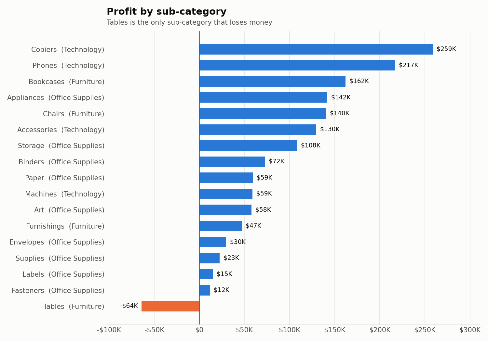

# Global Superstore — SQL + Tableau Sales Analytics

End-to-end sales analysis of the Global Superstore dataset (51,290 order lines, 2011–2014):
**MySQL 8** for cleaning and analysis → **Excel** summary workbook → **Tableau** interactive dashboards.

**Tableau dashboard:** download [`tableau/Global_Superstore_Dashboard.twbx`](tableau/Global_Superstore_Dashboard.twbx) and open it in the free [Tableau Public desktop app](https://public.tableau.com/app/download). It contains 3 interactive dashboards, with the data built in.



Every number in this README comes from a query in [`sql/03_analysis.sql`](sql/03_analysis.sql),
executed against MySQL 8.4 and saved to [`outputs/`](outputs/).

## Pipeline

```
data/*.csv ──► sql/01_schema.sql          create tables + indexes
           ──► sql/02_load_and_clean.sql  LOAD DATA + cleaning fixes
           ──► sql/03_analysis.sql        22 analysis queries ──► outputs/*.csv
           ──► sql/04_tableau_view.sql    enriched view       ──► tableau/superstore_tableau_source.csv
outputs/*.csv ──► scripts/build_reports.py      ──► outputs/analysis_summary.xlsx + charts/*.png
tableau csv   ──► scripts/build_tableau_workbook.py ──► Hyper extract + tableau/Global_Superstore_Dashboard.twbx
```

### Reproduce

Requires MySQL 8.0+ (CTEs and window functions) with `local_infile` enabled, and Python 3.

```bash
pip install -r requirements.txt
```

```bash
mysql -u root -e "SET GLOBAL local_infile = 1;"
```

```bash
python3 scripts/run_sql.py
```

```bash
python3 scripts/build_reports.py
```

```bash
python3 scripts/build_tableau_workbook.py
```

`run_sql.py` uses the `mysql` command-line client. Connection settings come from `MYSQL_HOST`, `MYSQL_PORT`, `MYSQL_USER`, `MYSQL_PWD` and `MYSQL_BIN`.

## SQL techniques used

| Technique | Where |
|---|---|
| Multi-table `JOIN` / `LEFT JOIN` (Orders ⟷ Returns on Order ID + Market, Orders ⟷ People) | `kpi_summary`, `return_rate_by_market`, `return_rate_by_category`, `manager_performance`, `v_orders_enriched` |
| CTEs, including chained CTEs | `yearly_performance`, `monthly_performance`, `top5_subcategory_share`, `region_performance`, product/customer rankings |
| Window functions: `LAG`, `FIRST_VALUE`, `RANK`, `DENSE_RANK`, `ROW_NUMBER` | YoY growth, cumulative growth, rankings, top-N |
| Windowed aggregates: `SUM() OVER (PARTITION BY … ORDER BY …)`, `AVG() OVER (ROWS BETWEEN 2 PRECEDING …)`, `SUM(SUM()) OVER ()` | YTD running totals, 3-month moving average, share of total |
| Aggregation, `GROUP BY` / `HAVING`, `CASE` banding, `GROUP_CONCAT` | discount bands, loss-making products, manager → markets |
| Statistics in SQL | Pearson correlation of Discount vs Profit |
| Data-quality checks | duplicates, nulls, orphaned returns, join coverage |

## Data cleaning (done in SQL)

| Issue in source | Fix |
|---|---|
| `Postal Code` stored as float text (`10024.0`), US ZIPs lost leading zeros | strip `.0`, `LPAD` US ZIPs to 5 digits, blanks → `NULL` |
| Returns label the US market `United States`; Orders use `US` | normalised so Returns join on **(Order ID, Market)** |
| People spell the EMEA region `AMEA` | corrected so every region has a manager |
| 37 Order IDs exist in two markets | Returns joined on Order ID **and** Market. This fixes 7 lines that the old CSV `Returned` flag marked in the wrong market |
| `Customer ID` is issued per market (1,590 IDs for 795 people) | customers counted by name |
| `Product ID` is not unique per product (10,292 IDs, 3,788 names) | products counted and ranked by name |
| 9 line pairs identical except `Row ID` | kept (they're in the source workbook), reported in `data_quality_checks` |

## Headline KPIs

| KPI | Value |
|---|---:|
| Total Sales | $12,642,501.91 |
| Total Profit | $1,467,457.29 |
| Profit Margin | 11.61% |
| Orders | 25,035 |
| Order lines | 51,290 |
| Customers | 795 |
| Products | 3,788 |
| Quantity Sold | 178,312 |
| Average Order Value | $504.99 |
| Returned Orders | 1,172 (4.68% of all orders; 5.8% within the 4 markets that record returns) |
| Sales growth 2011 → 2014 | **+90.31%** |

## Key findings

1. **Strong, consistent growth.** Sales rose from $2.26M (2011) to $4.30M (2014). Year-over-year growth was +18.50%, +27.20% and +26.25%. Profit grew faster than sales in 2012 (+23.5%) and 2013 (+32.4%), then slightly slower in 2014 (+23.9%).
2. **Technology leads.** It makes 37.5% of sales and 45.2% of profit at a 13.99% margin. Furniture has a similar sales volume (32.5%) but only a 6.94% margin.
3. **Sales are concentrated.** Phones, Copiers, Chairs, Bookcases and Storage make up **57.83%** of sales.
4. **Tables is the only loss-making sub-category.** It had $757K of sales and **–$64K profit** (–8.46% margin). Undiscounted, Tables earns a 23.1% margin. Above a 40% discount it loses 76.7%.
5. **Discounts above 20% destroy profit.** Lines discounted above 20% generated $1.93M sales but **–$814.7K profit** (–42.2% margin), compared with +21.3% for lines at or below 20%. The 20–30% band is already negative. Discount–Profit correlation is r = **–0.3165**.
6. **Regional spread.** Canada has the highest margin (26.6%) but only $67K of sales. Among large regions, North Asia (19.5%) and Central Asia (17.6%) lead. Southeast Asia earns just 2.0% on $884K of sales, and EMEA earns 5.5%. EU-Central is the largest single region by sales ($1.72M). *(Central, North and South are shared names across markets, so regions are analysed as Market + Region.)*
7. **Returns.** Return rates are 5.4–6.2% in the four markets that record returns (EU 6.18%, US 5.91%, LATAM 5.78%, APAC 5.44%). Africa, Canada and EMEA have **no return records at all**, which means returns aren't tracked there, not that the rate is zero.
8. **Shipping mode doesn't change margin** (11.4–11.8% across all modes). Same Day costs 17.4% of sales in shipping, compared with 8.1% for Standard Class.

## Recommendations

1. Cap discounts at 20%, and require approval above it, especially for Tables, Machines and Phones.
2. Re-price Tables or stop discounting them heavily. It's the only sub-category with an overall loss.
3. Investigate Southeast Asia and EMEA margins before adding sales incentives there.
4. Protect high-margin Technology lines (Copiers 17.1%, Accessories 17.3%).
5. Start recording returns in Africa, Canada and EMEA so return rate can be tracked globally.

## Deliverables

| Path | What it is |
|---|---|
| [`sql/`](sql/) | MySQL 8 schema, load/clean, 22 analysis queries, Tableau view |
| [`outputs/*.csv`](outputs/) | Result of each analysis query, as exported from MySQL |
| [`outputs/analysis_summary.xlsx`](outputs/analysis_summary.xlsx) | Excel workbook: Dashboard sheet with formula-driven KPIs and native Excel charts, plus one formatted sheet per query |
| [`charts/`](charts/) | 7 static charts built from the SQL outputs |
| [`tableau/Global_Superstore_Dashboard.twbx`](tableau/Global_Superstore_Dashboard.twbx) | Tableau workbook (open this one): 3 interactive dashboards, 17 worksheets, with a built-in Hyper extract |
| [`tableau/Global_Superstore_Dashboard.twb`](tableau/Global_Superstore_Dashboard.twb) + [`tableau/Data/`](tableau/Data/) | Same workbook, unpackaged, for reading the XML |
| [`tableau/superstore_tableau_source.csv`](tableau/superstore_tableau_source.csv) | Line-level data exported from the MySQL view `v_orders_enriched` |
| [`TABLEAU_DASHBOARD_GUIDE.md`](TABLEAU_DASHBOARD_GUIDE.md) | Dashboard contents, calculated fields, how to open the workbook |
| [`PROJECT_REPORT.md`](PROJECT_REPORT.md) | Full project report |
